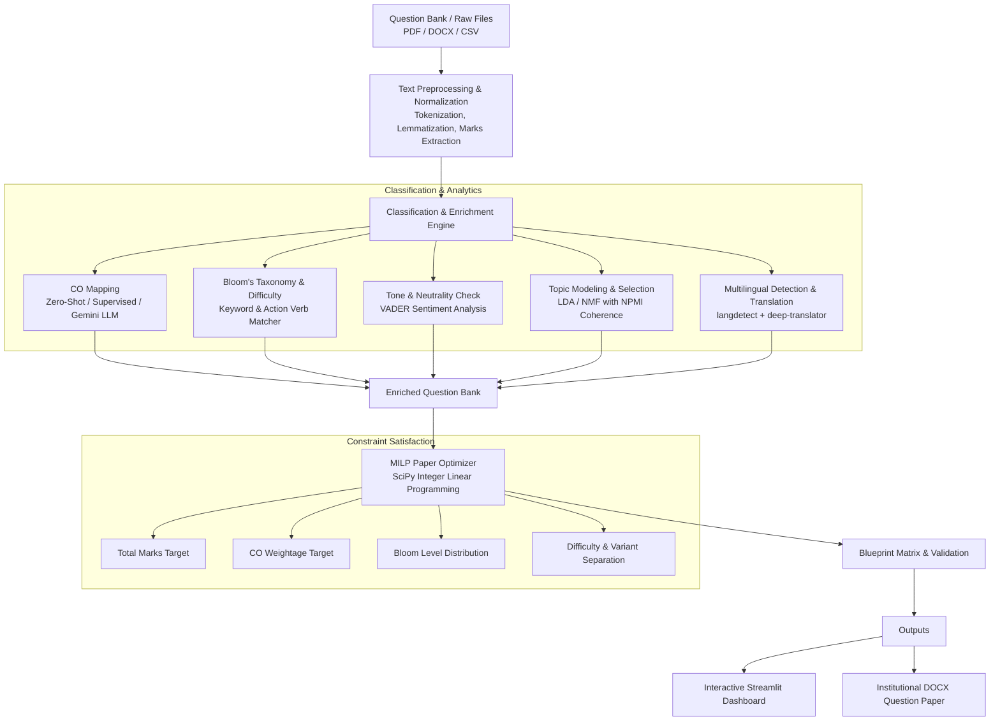

[README.md](https://github.com/user-attachments/files/35290707/README.md)
# 📝 Intelligent Question Paper Blueprint Generator

An end-to-end NLP and AI-driven system designed to automate curriculum-aligned question paper generation following **Outcome-Based Education (OBE)** standards. The system ingests question banks (PDF, DOCX, CSV), automatically maps questions to **Course Outcomes (CO1–CO4)** and **Bloom’s Taxonomy** cognitive levels, performs topic modeling and sentiment/tone validation, and utilizes **Mixed-Integer Linear Programming (MILP)** to generate mathematically balanced, constraint-satisfying question papers exportable directly to Microsoft Word (`.docx`).

---

## 🌟 Key Features

- **Multi-Format Ingestion & Information Extraction**:
  - Ingests raw question banks from PDF (with OCR fallback), DOCX, and CSV formats.
  - Automatic extraction of question text, sub-questions, and marks allocation using regex and pattern parsing.

- **Outcome-Based Education (OBE) & Bloom's Taxonomy Alignment**:
  - **Course Outcome Mapping**: Multi-tiered mapping strategy:
    - *Zero-Shot Mapping*: Cosine similarity using TF-IDF / Sentence Transformers (`all-MiniLM-L6-v2`) combined with keyword heuristic priors.
    - *Supervised Classification*: Stratified k-fold cross-validated classifiers (Logistic Regression / SVM / Naive Bayes) fitted on clean training folds.
    - *Hybrid LLM Classification*: Gemini API integration with structured JSON validation, retry/exponential backoff, and fallback mechanisms.
  - **Cognitive Level Classification**: Maps questions across Bloom’s Taxonomy levels (*Remember, Understand, Apply, Analyze, Evaluate, Create*) with automated difficulty scoring (*Easy, Medium, Hard*).

- **Topic Modeling & Coherence Selection**:
  - Supports LDA (Latent Dirichlet Allocation) and NMF (Non-Negative Matrix Factorization).
  - Automated hyperparameter selection for optimal topic count ($k$) using **NPMI** / Topic Coherence and minimum topic size penalties (preventing trivial $k$ explosion).

- **Multilingual Support & Language Detection**:
  - Language identification via `langdetect` (seeded for reproducibility) and AWS Comprehend fallback.
  - Automated translation into English via `deep-translator` (Google Translate engine) to enable seamless processing of regional/bilingual questions (e.g., Hindi).

- **Tone & Exam Feedback Analysis**:
  - **Question Tone Verification**: Uses VADER sentiment analysis to ensure questions are neutrally phrased, objective, and unambiguous.
  - **In-Domain Exam Feedback Classifier**: Evaluates student/faculty exam reviews without domain mismatch (overcoming traditional movie-review bias).

- **MILP Mathematical Optimization**:
  - Formulates question paper assembly as a **Mixed-Integer Linear Program (MILP)** solved via `scipy.optimize.milp` / `linprog` with heuristic relaxation.
  - Guarantees exact constraints:
    - Target total marks (e.g., 50 or 100 marks).
    - Strict CO weight distribution (e.g., 25% per CO).
    - Balanced Bloom cognitive distribution (Lower-order vs. Higher-order thinking skills).
    - Difficulty balance and section partitioning (Part A, Part B).
    - Support for distinct paper sets (Set A vs. Set B) with near-duplicate penalties.

- **Formatted DOCX Export & Streamlit Web UI**:
  - Clean, institutional-grade DOCX export featuring institutional header, test metadata, general instructions, section breaks, and CO/Bloom tags.
  - Full-featured **Streamlit web application** with interactive Plotly visualisations, question bank editor, live blueprint generation, and LLM review/generation tools.

---

## 🏗️ Architecture & Pipeline Flow



---

## 📁 Repository & Project Structure

The notebook is fully self-contained and modular. Executing it generates the core library, web app, and directory structure:

```text
├── Nlp_Project_clean.ipynb      # Main Jupyter notebook (execution pipeline)
├── nlp_core.py                  # Core backend module (written out by Cell 3)
├── app.py                       # Streamlit web application (written out by Cell 20)
├── requirements.txt             # Project dependencies (written out by Cell 21)
├── data/
│   └── sample_question_bank.csv # Default sample question bank
├── models/
│   └── co_classifier.joblib     # Serialized CO classification model
├── outputs/
│   ├── question_paper.docx      # Generated Word document
│   └── blueprint_summary.json   # Exported paper metadata & distributions
└── .streamlit/
    └── config.toml              # Streamlit UI configuration
```

---

## ⚙️ Installation & Setup

### 1. Environment Requirements
- Python 3.9 – 3.11 recommended.
- Works in **Google Colab**, **JupyterLab / VS Code**, or standard local terminal.

### 2. Install Dependencies
Run the pip installation command directly or use `requirements.txt`:

```bash
pip install -r requirements.txt
python -m spacy download en_core_web_sm
```

*(Note: `nlp_core.py` includes lightweight regex fallbacks if `spaCy` or `sentence-transformers` are not installed).*

### 3. API Keys & Environment Variables (Optional)
If using the Gemini LLM features (question generation, LLM review, or hybrid CO mapping):

```bash
export GEMINI_API_KEY="your-gemini-api-key"
export GEMINI_MODEL="gemini-2.5-flash"   # Optional: defaults to gemini-2.5-flash
export USE_EMBEDDINGS="1"                 # Optional: enables sentence-transformers
```

In Google Colab, you can also store `GEMINI_API_KEY` in Colab Secrets or enter it securely when prompted by the notebook.

---

## 🚀 How to Run

### Option A: Execute the Jupyter Notebook
Open `Nlp_Project_clean.ipynb` and run cells top-to-bottom:
1. **Setup & Core Module**: Cells 0–4 create directories and write `nlp_core.py`.
2. **CO1 (Extraction & Preprocessing)**: Demonstrates text cleaning, lemmatization, and vectorization.
3. **CO Mapping Evaluation**: Runs both zero-shot and honest stratified k-fold cross-validation.
4. **CO3 (Topic Modeling & Multilingual)**: Computes coherence curves for topic model selection and demonstrates translation.
5. **CO2 (Sentiment & Tone Check)**: Runs VADER tone evaluation and in-domain feedback classification.
6. **CO4 (LLM Integration)**: Calls Gemini API for hybrid classification, AI-assisted question generation, and Bloom review.
7. **MILP Optimization & DOCX Export**: Solves the integer programming model and exports `question_paper.docx`.
8. **Streamlit App Generation**: Writes `app.py` and provides a launcher.

### Option B: Launch the Interactive Streamlit Web App
Once `nlp_core.py` and `app.py` are generated:

```bash
streamlit run app.py
```

The Streamlit UI provides:
- **Dashboard Overview**: Summary KPIs for available questions, total marks, and CO balance.
- **Question Bank Manager**: Filter, search, add, or edit questions and cognitive labels.
- **Blueprint Generator**: Interactive sliders for target marks, CO proportions, and difficulty distributions with one-click generation.
- **LLM Question Generator & Reviewer**: Prompt the Gemini model to suggest new questions for deficit Course Outcomes.
- **Download Center**: One-click download of the generated paper in DOCX format.

---

## 📊 Modules & Core Functions in `nlp_core.py`

| Function Group | Key Functions | Description |
| :--- | :--- | :--- |
| **Ingestion & Extraction** | `read_raw_text()`, `split_questions()`, `extract_marks()`, `load_question_bank()` | Reads PDF/DOCX/CSV and extracts question items and marks. |
| **Preprocessing & Embeddings** | `clean_text()`, `preprocess_batch()`, `embed()`, `vectorize()` | Tokenization, stopword removal, lemmatization, and vector representation. |
| **CO Classification** | `map_to_co()`, `build_co_classifier()`, `cross_validate_co()`, `evaluate_co_mapping()` | Zero-shot and supervised Course Outcome classification with cross-validation. |
| **Bloom & Tone Analytics** | `detect_bloom()`, `extract_info()`, `tone_check()` | Bloom action verb tagging, difficulty scoring, and VADER sentiment checks. |
| **Topic Modeling** | `topic_model()`, `topic_coherence()`, `select_topic_model()` | LDA / NMF models with automated coherence-driven $k$ selection. |
| **Multilingual** | `detect_language()`, `translate_to_english()`, `make_multilingual_ready()` | Language identification and translation pipelines. |
| **LLM Integration** | `call_llm()`, `hybrid_map_to_co()`, `llm_generate_questions()`, `llm_review()` | Gemini API wrappers with JSON parsing and fallback error handling. |
| **Optimization & Export** | `optimise_paper()`, `build_blueprint()`, `export_paper_docx()`, `run_pipeline()` | SciPy MILP solver, blueprint distribution table, and DOCX document builder. |

---

## 📈 Evaluation & Optimization Methodology

- **Honest CO Mapping Evaluation**: Separates test folds strictly before vectorizer fitting to prevent data leakage.
- **Topic Coherence (NPMI)**: Evaluates semantic co-occurrence of top-ranked words instead of relying on perplexity.
- **MILP Formulation**:
  $$\min \sum c_i x_i \quad \text{subject to} \quad \sum m_i x_i = M_{\text{target}}, \quad \mathbf{A}_{\text{CO}} \mathbf{x} \approx \mathbf{w}_{\text{CO}} M_{\text{target}}$$
  where $x_i \in \{0, 1\}$ represents whether question $i$ is included, $m_i$ represents question marks, and duplicate penalties ensure diverse question selection.

---

## 📄 License
Academic and Educational Use. Developed for NLP Course Project / Outcome-Based Education (OBE) automation.
